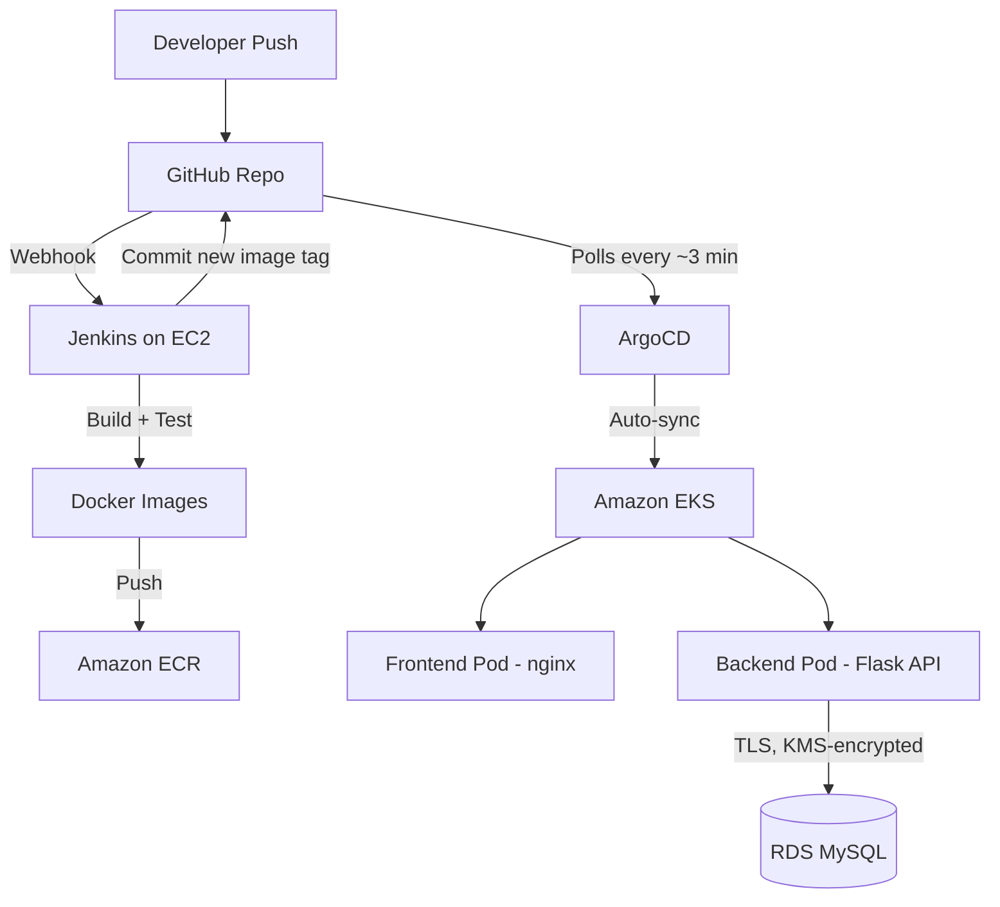
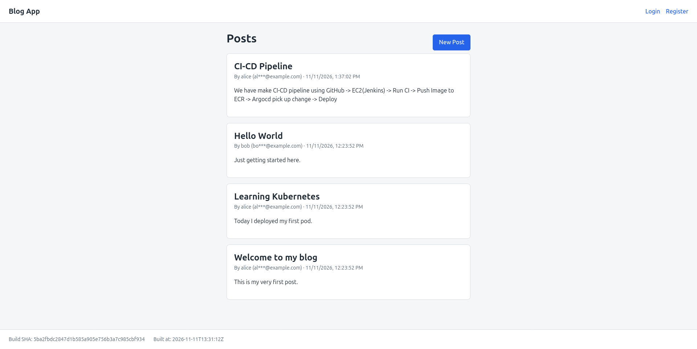
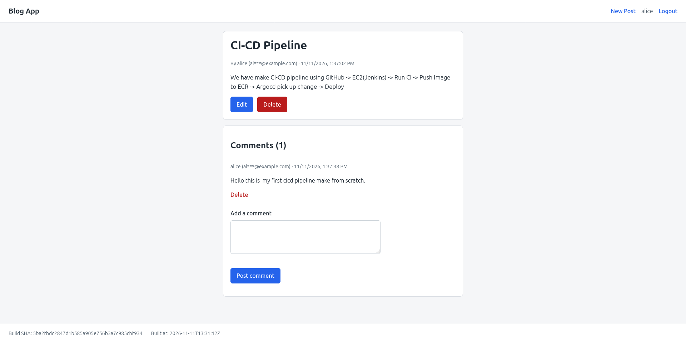
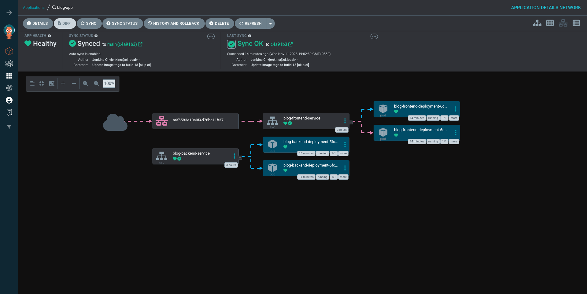
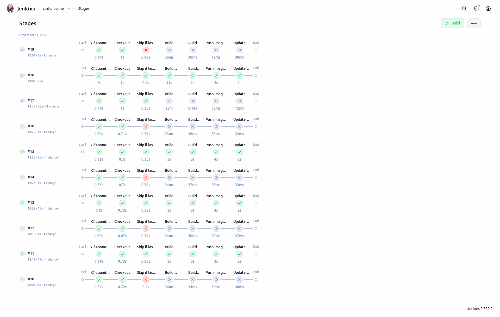
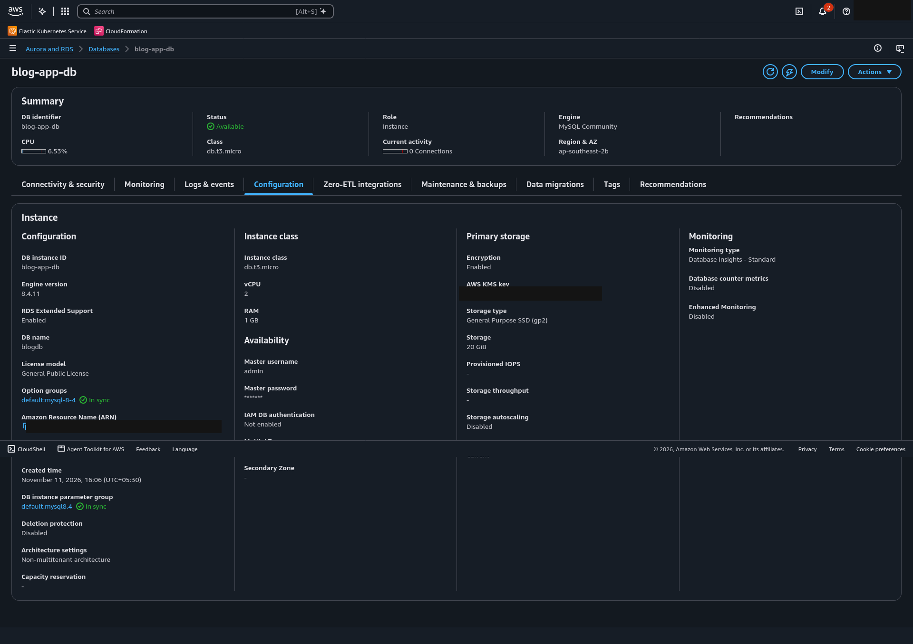

# Jenkins + ArgoCD + EKS CI/CD Pipeline

A complete, self-built CI/CD pipeline deploying a full-stack blog application
(Python Flask + MySQL) to AWS EKS, using Jenkins for CI and ArgoCD for GitOps
continuous delivery.

This project was built end-to-end on a personal AWS account — including the
VPC, EC2, Jenkins, ECR, EKS, ArgoCD, and RDS, all wired together manually to
understand every layer of a real CI/CD pipeline, not just run a tutorial.

---

## Architecture



**Flow:** Push to GitHub → Jenkins builds and tests the app, pushes Docker
images to ECR, then commits the new image tag back to the repo → ArgoCD
detects the commit and automatically syncs the cluster to match → Kubernetes
rolls out the new version with zero manual deployment steps.

---

## Tech Stack

| Layer | Technology |
|---|---|
| CI | Jenkins (self-hosted on EC2, Amazon Linux 2023) |
| CD | ArgoCD (GitOps, auto-sync + self-heal) |
| Container Registry | Amazon ECR (separate repos for frontend/backend) |
| Orchestration | Amazon EKS (managed node group, 2× t3.small) |
| Database | Amazon RDS MySQL (KMS-encrypted, private subnets) |
| Networking | Custom VPC, public + private subnets across 2 AZs |
| Backend | Python, Flask |
| Frontend | Plain HTML/CSS/JavaScript, served via nginx |
| Source control | GitHub (private repo) |

---

## Application Features

- User registration and login (bcrypt-hashed passwords, session-based auth)
- Create, edit, and delete blog posts — ownership-enforced (only the author
  can edit/delete their own content)
- Comment on posts, with the same ownership rules
- Public author emails are masked (`al***@example.com`); a user sees their
  own real email only on their own profile
- `/health` and `/version` endpoints — used for Kubernetes probes and to
  visually confirm a new deployment went live (build SHA + timestamp shown
  in the footer)

---

## Security Practices

- Passwords hashed with bcrypt — never stored or returned in plaintext
- Public API responses never include `password_hash`, under any endpoint
- RDS encrypted at rest with a **customer-managed KMS key** (not the AWS
  default key)
- RDS lives in **private subnets**, not publicly accessible — reachable
  only from EKS worker nodes via a scoped security group rule
- Backend Kubernetes Service is **ClusterIP** (internal-only) — only the
  frontend is exposed to the internet
- Database credentials passed to the backend via a **Kubernetes Secret**,
  never committed to Git
- Jenkins's IAM role is scoped to exactly what it needs (ECR push) — no
  broad admin permissions
- Logout properly invalidates the server-side session (found and fixed a
  real bug here during testing — see below)

---

## Screenshots

### **Home page (logged out)** — masked author emails, publicly visible posts


### **Post detail (logged in as the author)** — comments, edit/delete controls,
and the real build SHA/timestamp footer


### **ArgoCD — auto-sync in action** — synced automatically from Jenkins's own
commit (`Author: Jenkins CI`, `[skip ci]`), with zero manual intervention


### **Jenkins — pipeline build history** — repeated successful builds across
every phase of development


### **RDS — encryption confirmed** — customer-managed KMS key, not the AWS default


---

## Project Structure

```
.
├── application/
│   ├── backend/                # Flask API, Dockerfile, DB schema + seed data
│   └── frontend/               # Static HTML/CSS/JS, nginx config, Dockerfile
├── kubernetes/                 # Deployment + Service manifests (watched by ArgoCD)
├── argocd/                     # ArgoCD Application definition (bootstrap only)
├── Jenkinsfile                 # CI pipeline definition
├── pipeline-setup-guide.md     # Full AWS CLI setup guide (create → delete)
└── blog-app-build-plan.md      # Phased application build plan (v0.1 → v0.9)
```

---

## Setup

This repo does not repeat setup commands in this README — the full,
copy-paste-ready AWS CLI walkthrough (VPC through RDS, plus teardown) lives
in **[`pipeline-setup-guide.md`](./pipeline-setup-guide.md)**. The
application's phased build plan is in
**[`blog-app-build-plan.md`](./blog-app-build-plan.md)**.

---

## Real Issues Hit and Fixed

Building this surfaced genuine problems, not just following a checklist —
these were debugged and resolved along the way:

- **Jenkins wouldn't start** — the installed Jenkins version required Java
  21; Java 17 was installed initially based on outdated guidance
- **EC2 instance type wasn't free-tier eligible** in this account/region —
  `t2.micro` rejected, resolved by switching to `t3.micro`
- **Jenkins's Built-In Node kept going offline** — `/tmp` on a micro
  instance is a small RAM-backed filesystem that could never clear
  Jenkins's default 1 GiB threshold; fixed by resizing `/tmp`
- **GitHub webhook couldn't reach Jenkins** — the EC2 security group only
  allowed traffic from one IP (for admin access), which also blocked
  GitHub's own webhook delivery servers
- **Jenkins couldn't clone the repo at all** — `git` was never installed
  on the EC2 instance in the first place
- **EKS nodegroup creation failed** — subnets didn't have
  "auto-assign public IP" enabled, which `--associate-public-ip-address`
  (a per-instance flag) doesn't cover for EKS's own managed node groups
- **Infinite CI loop risk** — Jenkins's own commits (bumping image tags)
  would re-trigger the pipeline; solved with a `[skip ci]` commit-message
  check as the pipeline's first real stage
- **Logout didn't actually invalidate sessions** — found via manual
  testing: the old session cookie still worked after "logging out"; fixed
  in the backend
- **Authorization test initially inconclusive** — a validation rule
  requiring all fields on edit masked whether ownership checks worked at
  all; re-tested properly once discovered

---

## What I'd Add Next

- Migrate RDS MySQL to Aurora MySQL-compatible, to compare the two
- Add Ingress + AWS Load Balancer Controller to support multiple services
  behind one load balancer
- Move the ArgoCD bootstrap manifest and account ID references to a
  templated (Helm/Kustomize) setup, so the repo could safely go public
  without exposing AWS account details
- Add horizontal pod autoscaling and basic load testing